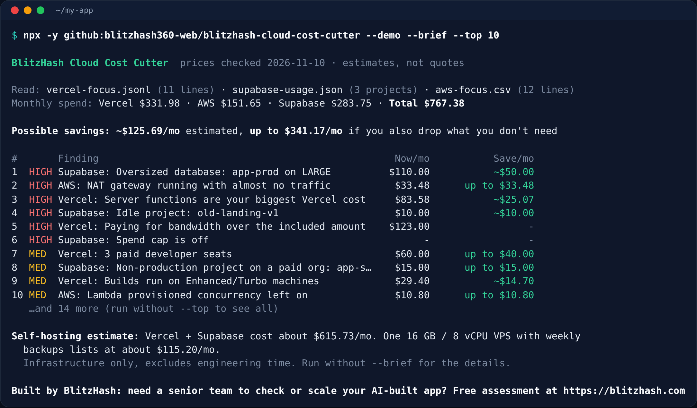

# BlitzHash Cloud Cost Cutter

**Find the waste in your Vercel, Supabase and AWS bills in plain English: oversized databases, idle projects, wasteful functions and bandwidth, forgotten add-ons, plus an honest self-hosting estimate.**

[](https://github.com/blitzhash360-web/blitzhash-cloud-cost-cutter/actions/workflows/ci.yml)
[](LICENSE)
[](package.json)
[](package.json)
[](docs/PRICING.md)
[](https://blitzhash.com)

You built your app with Lovable, Bolt, Replit, Cursor or v0, put it on Vercel and Supabase (maybe some AWS), and the bill keeps creeping up. This tool reads the usage files those services already give you and tells you, line by line, what's costing money for no reason and what to do about it. No logins, no API keys, nothing uploaded. Savings are estimates, and every one shows its assumption and the public price page it came from.


<sub>Real output of `--demo --brief --top 10` on the sample files in [fixtures/demo](fixtures/demo).</sub>

## Quick start (3 steps)

You need [Node.js 18 or newer](https://nodejs.org). Nothing else.

```bash
# 1. See it work on sample bills (no files, no keys)
npx -y github:blitzhash360-web/blitzhash-cloud-cost-cutter --demo

# 2. Get your own usage files (2 to 10 minutes, see docs/EXPORTS.md)
vercel billing usage --json > vercel-usage.json

# 3. Run it on your files
npx -y github:blitzhash360-web/blitzhash-cloud-cost-cutter vercel-usage.json supabase-usage.json
```

Prefer to read the code first? `git clone https://github.com/blitzhash360-web/blitzhash-cloud-cost-cutter && cd blitzhash-cloud-cost-cutter && node bin/cost-cutter.js --demo`

Useful options: `--brief` (summary only), `--top 10`, `--markdown report.md` (share with your team), `--json`, `--assume functions_cacheable_share=0.2`. Run `--help` for all of them.

## What it reads

| Provider | File | How to get it |
|---|---|---|
| Vercel | `vercel billing usage --json` or the FOCUS billing charges API (JSONL) | [docs/EXPORTS.md#vercel](docs/EXPORTS.md#vercel) |
| Supabase | A small JSON snapshot you fill in from the dashboard ([template](templates/supabase-usage.template.json)) | [docs/EXPORTS.md#supabase](docs/EXPORTS.md#supabase) |
| AWS | Data Exports in FOCUS 1.2 format, or a Cost and Usage Report (CSV or `.csv.gz`) | [docs/EXPORTS.md#aws](docs/EXPORTS.md#aws) |
| Anything | A simple CSV ([template](templates/usage-template.csv)) | [docs/EXPORTS.md#any-provider-simple-csv](docs/EXPORTS.md#any-provider-simple-csv) |

## What it checks

| Check | Provider | What it tells you |
|---|---|---|
| Oversized database | Supabase | Production compute running at low CPU and RAM, and what one size down costs |
| Idle project | Supabase | Paid projects with no requests in weeks (paid projects never pause) |
| Dev or staging on a paid org | Supabase | Full-time test projects that could be a free project or a short-lived branch |
| Spend cap off | Supabase | No ceiling on overage. A risk flag, not a saving |
| PITR, branches, log drains | Supabase | Add-ons billed by the month or hour, and when you might not need them |
| Egress overage | Supabase | Data over the included 250 GB, and how much cached egress could save |
| Functions are the biggest cost | Vercel | Function share of your bill, and whether functions mostly wait on a database or API |
| Bandwidth overage | Vercel | Fast Data Transfer over the included 1 TB |
| Extra developer seats | Vercel | People who could be free Viewer seats |
| Big build machines | Vercel | Enhanced/Turbo build minutes vs Standard |
| Forgotten add-ons | Vercel | Observability Plus, Speed Insights, password protection, static IPs and more |
| Images, ISR, old deployments | Vercel | Image transformation spend, pages rebuilt more than read, deployment storage |
| Idle public IPs | AWS | Elastic IPs attached to nothing, billed every hour |
| Quiet NAT gateway | AWS | A NAT gateway you pay for by the hour with almost no traffic |
| gp2 disks | AWS | Volumes that cost about 20% less as gp3 |
| Snapshots, logs, data out | AWS | Growing snapshot, CloudWatch Logs and internet transfer costs |
| Old server types, always-on servers | AWS | Previous-generation instances and steady servers at on-demand prices |
| Lambda provisioned concurrency | AWS | Warm capacity billed whether or not requests come |
| Self-hosting estimate | Vercel + Supabase | Your monthly spend vs one plain VPS, with everything it leaves out spelled out |

Each finding says what it saw, why it costs you, what to do, the saving (`~$` estimate, `up to $` if you turn it off, or `-` when billing data can't tell), the assumption, and the price page. See [docs/PRICING.md](docs/PRICING.md) for every price and assumption.

## Honest about the numbers

- **Prices were checked on 2026-11-10** from the public pricing pages of [Vercel](https://vercel.com/pricing), [Supabase](https://supabase.com/pricing), [AWS](https://aws.amazon.com/vpc/pricing/) ([EBS](https://aws.amazon.com/ebs/pricing/), [Lambda](https://aws.amazon.com/lambda/pricing/)) and [DigitalOcean](https://www.digitalocean.com/pricing/droplets) (VPS example). They change. All list prices are in [src/pricing.json](src/pricing.json).
- **Savings are estimates, not quotes.** They exclude taxes, discounts, credits and the engineering time a change takes. Some overlap.
- **It only knows what's in your files.** It can't see your code, traffic patterns or business needs. A flag means "look at this", not "turn this off".
- **The demo files are made up** to show every check. Their prices follow the list prices above.

## Going to production? What this doesn't cover

This tool finds the obvious waste. Cutting a bill safely, without slowing the app down or losing data, takes more:

- **Real cost tuning:** finding which routes, queries and files drive the bill, then caching, query and bundle fixes, measured before and after.
- **Reserved capacity:** Savings Plans, reserved instances and committed-use deals only pay off after right-sizing, and lock you in for 1 to 3 years.
- **Migrations:** moving a database, storage or auth between providers, or between plans, without downtime or lost users.
- **Self-hosting safely:** hardening, tested backups and restores, updates, secrets and an on-call plan. Our [Supabase self-host kit](https://github.com/blitzhash360-web/blitzhash-supabase-selfhost-kit) is a starting point.
- **Monitoring:** spend alerts, budgets and dashboards so the next surprise shows up in a day, not on the invoice.

Want a senior team to look at it? Get a [free assessment at blitzhash.com](https://blitzhash.com), or start with the free 15-minute launch review call: we look at your AI-built app and tell you what's risky.

## More free BlitzHash tools

- [blitzhash-launch-ready-check](https://github.com/blitzhash360-web/blitzhash-launch-ready-check): scan your live URL for security headers, leaked keys and launch basics. Score out of 100.
- [blitzhash-supabase-selfhost-kit](https://github.com/blitzhash360-web/blitzhash-supabase-selfhost-kit): self-host Supabase with hardening and backups when the estimate above makes sense.
- [blitzhash-vibe-coding-rules](https://github.com/blitzhash360-web/blitzhash-vibe-coding-rules): rules that make your AI coding tool write secure code by default.

## Run the tests

```bash
npm test                       # 17 tests: every fixture -> expected flags and savings
node bin/cost-cutter.js --demo # full report
```

CI runs the tests on Node 18, 20, 22 and 24, runs the demo, checks the expected flags for the sample files, checks every link and price page, and scans for committed secrets.

## Credits

- **FOCUS** (FinOps Open Cost and Usage Specification) by the FinOps Foundation: the open billing format Vercel and AWS export. We read its column names; no spec text or code is copied. <https://focus.finops.org>
- **Related open-source tools** (no code copied; worth a look for what this tool doesn't do):
  - [Aniket-508/vercel-doctor](https://github.com/Aniket-508/vercel-doctor) (MIT): scans your Next.js code for patterns that raise a Vercel bill. Pairs well with this tool's bill-side view.
  - [ravikiranvm/aws-finops-dashboard](https://github.com/ravikiranvm/aws-finops-dashboard) (MIT): live AWS cost and resource dashboard in the terminal, using your AWS credentials.
  - [infracost/infracost](https://github.com/infracost/infracost) (Apache-2.0): cost estimates for Terraform changes before you deploy.
- Prices: the public pricing pages listed in [docs/PRICING.md](docs/PRICING.md).

Vercel, Supabase, AWS and DigitalOcean are trademarks of their owners. This is an independent tool for their users. It isn't affiliated with or endorsed by them.

## License

MIT. See [LICENSE](LICENSE).

---

Built by BlitzHash: need a senior team to check or scale your AI-built app? Free assessment at https://blitzhash.com
